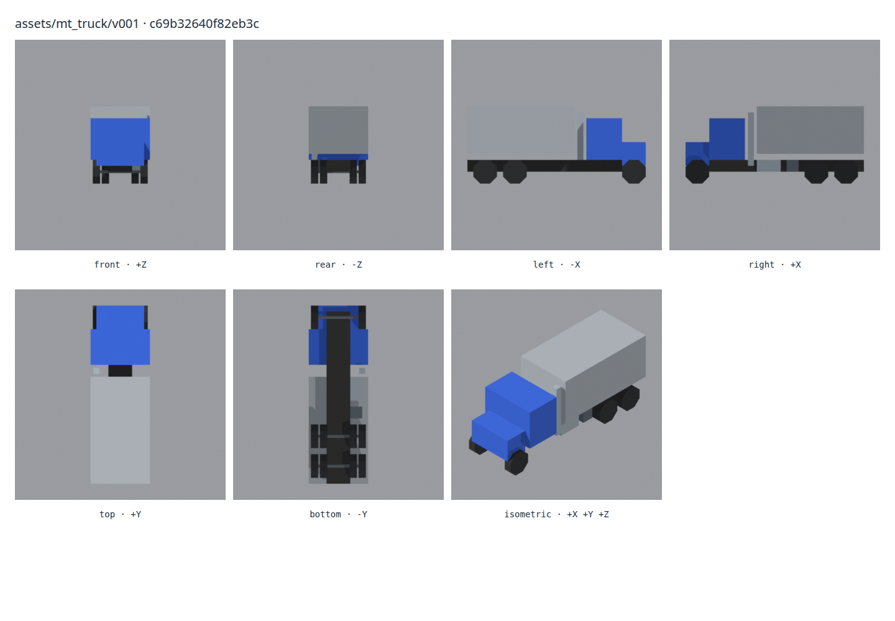

# Voxel Asset Registry

Create procedural blockouts, refine reusable components and assemble game
assets with Blender. A local web interface lets you browse recipes, compare
variants, change parameters, build GLB models and inspect their projections.

**Public alpha 0.1.0-alpha.1.** The starter collection contains trucks, a light
helicopter and a tower defence kit. Impressor prepares consistent reference
prompts and records the path from a sketch to verified 3D geometry.

[Русский](README.ru.md) · [Seven language pipeline guide](docs/guide/index.html)

[Download the alpha](https://github.com/Evafan1337/voxel-asset-registry/releases/tag/0.1.0-alpha.1)
for the source package, ready-to-import starter models and offline HTML guide.
The model archive contains 29 GLB files and 203 rendered views; it can be used
without installing this service. See [the pack guide](docs/STARTER_PACKS.md)
and [the development roadmap](docs/STARTER_ROADMAP.md).



## Install and start

The initial supported installation is Linux with Bash. Install Python 3.11+,
Node.js 20.19+ or 22.12+, and Blender 5.1+. This alpha is verified with Python
3.12, Node.js 24 and Blender 5.2. Godot 4 is optional for game export checks.

```bash
git clone https://github.com/Evafan1337/voxel-asset-registry.git
cd voxel-asset-registry
./run.sh
```

Open **http://127.0.0.1:8000**. The first launch prepares a Python environment
and builds the frontend; it needs internet access to install dependencies.
Recipes are included. Models are built on demand and cached locally.
The pipeline guide is also available at **http://127.0.0.1:8000/guide/en.html**.

If Blender is not in PATH, create `config.local.yaml`:

```yaml
blender_bin: /path/to/blender
```

See [config.example.yaml](config.example.yaml) for all supported settings.
The server binds to localhost by default. It is a local authoring tool and
should not be exposed as an unauthenticated shared web service.

## Your first model

Choose **Assets → mt_truck → v001**, then build it. Compare the real front,
back, left, right, top, bottom and isometric previews. Open a later variant
to see how form, structure and materials refine the same object.

Use the editor to save parameter or component changes as a new child
variant. Existing recipes remain available for comparison and rebuilding.

```bash
.venv/bin/python -m registry doctor --require-blender
.venv/bin/python -m registry check
.venv/bin/python -m registry build assets/mt_truck/v001
# Inspect or build the curated release targets:
.venv/bin/python -m registry build-demo --list
.venv/bin/python -m registry build-demo --pack mt_truck
```

## Starter collection

| Pack | What to explore |
| --- | --- |
| `zuk_truck` | Three development stages and an alternative wheel arch treatment |
| `td` | Three towers, three enemies, a cover prop and a path tile |
| `mt_truck` | Five stages of a modular truck assembled from reusable components |
| `evo_truck` | Truck evolution display and individual `vh_truck` vehicle stages |
| `evo_heli_light` | Helicopter evolution display and individual `vh_heli_light` stages |

The catalogue also contains the components and parent recipes required by
these packs. See [release/starter-packs.yaml](release/starter-packs.yaml) for
the exact build targets. Technical build success does not replace visual
review or a human approval decision.

## Materials and Godot

Palette colours and surface classes are part of the recipes. Material Lab
provides toon presets with Blender, browser and Godot implementations; its
public previews use models from the starter collection. These are current
material tools, not a texture painting application.

```bash
.venv/bin/python -m registry export-godot /path/to/godot-project assets/mt_truck/v005
```

Build the selected variant first. Export writes GLB and metadata into your
chosen project. Windows and macOS installation, container images and wider
Godot validation remain follow-up work; this alpha does not promise them.

## Impressor

```bash
.venv/bin/python -m impressor sketch impressor/templates/sketch_brief.example.yaml \
  --out var/impressor/truck_sheet_r001
```

This prepares the prompt, image request, resolved brief and manifest. Use an
image-capable agent to generate the actual sketch. The CLI does not call an
image API and contains no API key. Start with boxes, request six orthographic
views plus an isometric view, then verify the design against renders of one
real 3D model. A generated reference sheet is a proposal.

[Impressor workflow](impressor/README.md) ·
[Projection contract](impressor/PROJECTION_CONTRACT.md)

## Languages

The interface and guide offer English, Russian, Spanish, Brazilian
Portuguese, Simplified Chinese, French and German. EN/RU are the primary
review languages; additional translations welcome native-language review.
Technical IDs, recipes, user notes and build logs keep their original values.
Changing the interface language does not change model geometry.

## Development

Use Node.js 24 for the development checks below.

```bash
python3 -m venv .venv
.venv/bin/python -m pip install -r requirements-dev.txt
.venv/bin/python -m pytest -q
npm --prefix frontend ci
npm --prefix frontend test
npm --prefix frontend run typecheck
npm --prefix frontend run build
```

Use `./run.sh --dev` for the API and Vite development servers. Runtime data
belongs in ignored `build/` and `var/` directories. See
[CONTRIBUTING.md](CONTRIBUTING.md) and [AGENTS.md](AGENTS.md).

## Licenses

Software and documentation: [MIT](LICENSE). Included original demo recipe
data and models: [CC0-1.0](LICENSE-ASSETS). Demo models may be used and modified
in commercial games without attribution. Preserve the MIT notice when
redistributing the software. See [NOTICE](NOTICE) for the boundary between
code, content and third-party dependencies.
