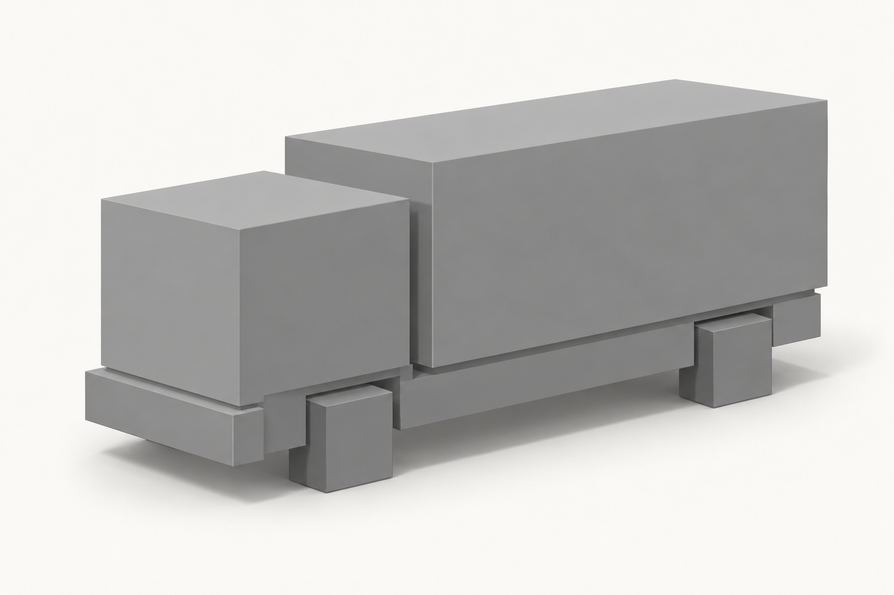

# Кубический скетч грузовика

Пример первого прохода `cube_massing`, созданный встроенным ImageGen по
[заданию](brief.resolved.yaml) и [общему шаблону](template.resolved.yaml).
Кабина, закрытый кузов, шасси и кубические заместители колёс задают крупную
компоновку перед процедурной сборкой.

[Промпт](prompt.txt), [аргументы инструмента](imagegen_request.json) и
[запись генерации и просмотра](manifest.json) сохраняют происхождение картинки.
Модель ImageGen инструмент не сообщил; в записи она оставлена пустой.

При просмотре массы различимы, видимые колёса кубические, окна и декор отсутствуют.
Это принятие референса агентом, а не статус `approved` варианта Registry.
Точные размеры, дальние колёса и стыки предстоит проверить на 3D блокауте.

Следующий вопрос: как читается силуэт после замены кубических колёс
низкополигональными цилиндрами с сохранением колёсной базы и крупных масс?
Для уточнения приложи `sketch.png` как `source_image`, запиши одно изменение
в `change` и сохрани новую итерацию по [инструкции](../../SKETCH_GENERATION.md).
