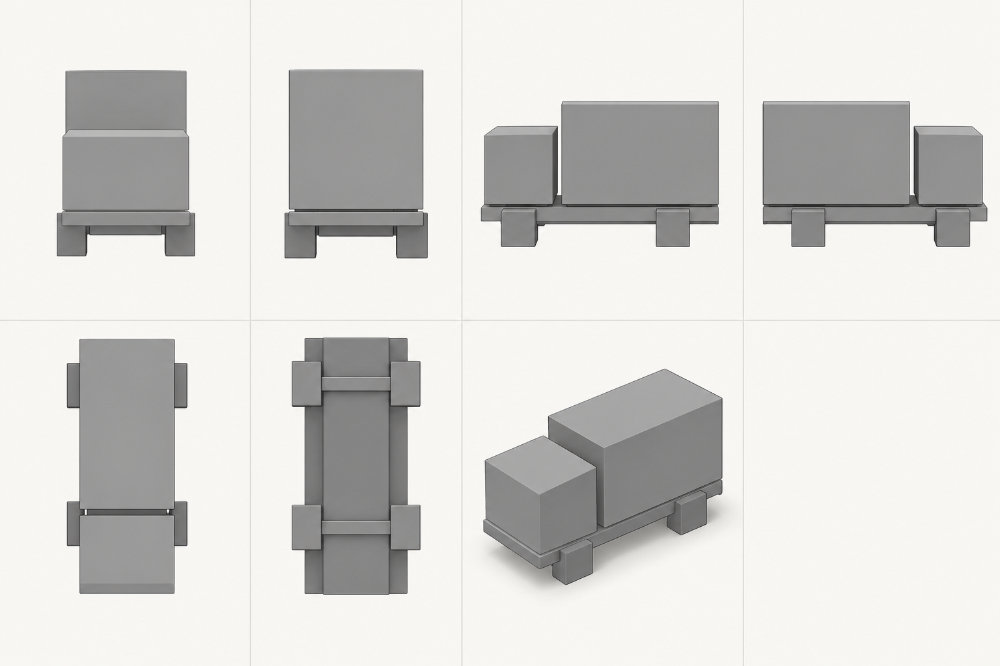

# Предложение семи видов грузовика

Лист создан встроенным ImageGen по [сохранённому заданию](brief.resolved.yaml)
и [промпту](prompt.txt). Первый ряд: front, rear, left, right. Второй ряд:
top, bottom, isometric и пустая ячейка.

Это учебный пример генерации референса. В [проверке](manifest.json) записан
`needs_review`: верхний вид развёрнут относительно +Z, а на боковых видах видны
верхние грани. Общий масштаб и геометрическая согласованность не подтверждены.

Принятие блокаута требует числовых масс и контрольных проекций одной 3D модели
по [контракту](../../PROJECTION_CONTRACT.md). Изображение подходит для обсуждения
компоновки и показывает, какие расхождения нужно проверять перед моделированием.
